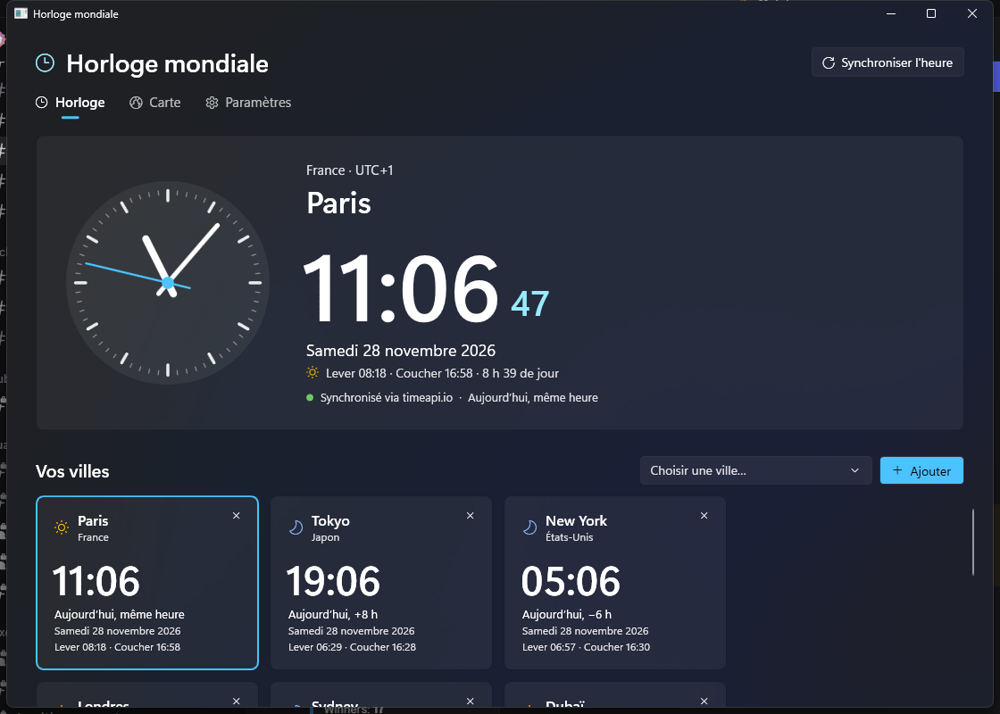
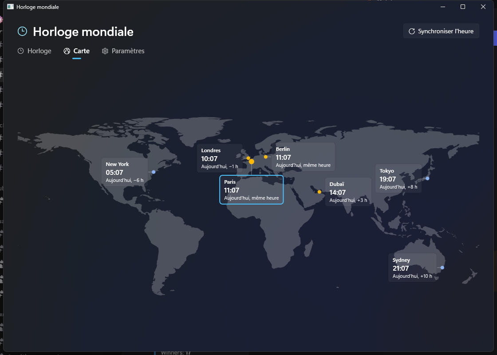
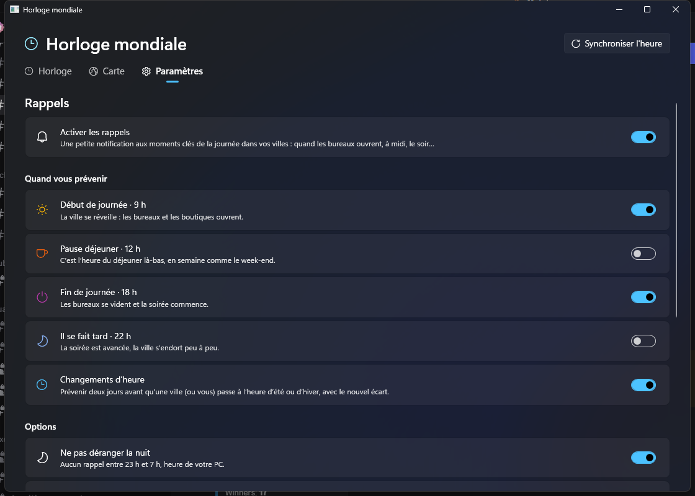

# Horloge mondiale


Application en **C#** (WPF, .NET 10) qui affiche l'heure de plusieurs villes du monde avec une interface moderne style Windows 11 (thème Fluent, clair/sombre automatique).



## Fonctionnalités

- Horloge analogique et numérique pour la ville sélectionnée
- Cartes par ville : heure, date, décalage (« Demain, +8 h »), icône jour/nuit calée sur le vrai soleil, heures de lever et de coucher du soleil récupérées via l'API [sunrise-sunset.org](https://sunrise-sunset.org/api)
- Onglet **Carte** : carte du monde avec chaque ville placée à sa position, son heure, son écart et un point jour/nuit ; un clic sélectionne la ville
- Ajout / suppression de villes, réorganisables par glisser-déposer (liste sauvegardée dans `%AppData%\ClockApp\villes.json`)
- Heure récupérée via l'API [timeapi.io](https://timeapi.io), resynchronisée toutes les 15 min
- Repli sur les fuseaux horaires de Windows si l'API est injoignable
- Onglet **Paramètres** avec des rappels activables (9 h, 12 h, 18 h, 22 h dans chaque ville) aux messages variés, regroupés par fuseau, avec mode « ne pas déranger » la nuit (réglages dans `%AppData%\ClockApp\parametres.json`)
- Alerte de changement d'heure : les cartes annoncent le passage à l'heure d'été ou d'hiver dans les 7 jours avec le nouvel écart, et une notification prévient deux jours avant
- Thème au choix : système, clair ou sombre
- Icône dans la zone de notification : fermer la fenêtre la range près de l'heure de Windows pour que les rappels continuent, avec une option pour lancer l'horloge au démarrage de Windows
- Menu du clic droit sur l'icône (style Windows 11) : heure de vos villes, accès direct à l'horloge, à la carte et aux paramètres, synchronisation et réglages rapides des rappels





## Lancer

Nécessite Windows et le SDK .NET 10.

- **Visual Studio 2026** : ouvrir `ClockApp.slnx` puis lancer le projet.
- **En ligne de commande** :

  ```
  dotnet run
  ```

## À faire

- [ ] Météo de chaque ville sur les cartes
- [ ] Setup d'installation
